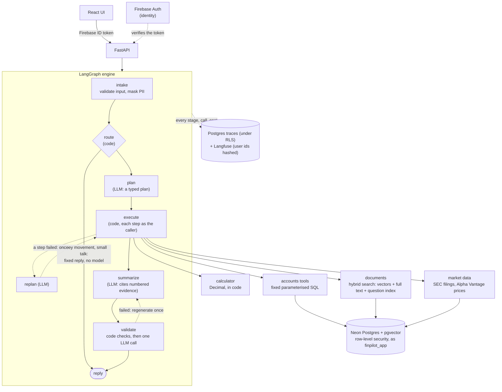

# FinPilot

FinPilot is a banking assistant for the customers of a fictional bank. A signed-in customer asks
in plain English ("Why was I charged $15 on April 6?", "Can I afford $1,200 this month and stay
above $500?"). FinPilot plans the steps, runs them through tools as that customer, checks the answer
before showing it, and cites every figure: their own accounts, the bank's documents, or public data.

**What it refuses to do:**
- **Move money or change accounts.** It's read-only; a transfer request gets a fixed reply.
- **Give investment, tax or legal advice.** It gives the facts instead.
- **Show another customer's data.** The database itself won't return it.

Bank staff get the same assistant over the bank's internal documents, with no access to customer
accounts.

**Status:** Phases 0 to 11 of 12 are built:
- data and ingestion
- Neon storage and retrieval
- the tools
- the reasoning engine and validation
- tracing
- the chat UI
- evaluation and the red-team set

Deployment (12) is scripted but not run. What each commit did, with measurements, is in
[docs/PROGRESS.md](docs/PROGRESS.md); the plan is in [docs/FINPILOT_PLAN.md](docs/FINPILOT_PLAN.md).

## Screens

A signed-in demo customer (synthetic data) asking why they were charged $15: the answer cites their
fee, the transaction that caused it and the fee schedule's rule.


| Dark theme | "How I got this" (the plan, the checks, where the time went) | Phone, 375 px |
|---|---|---|
|  |  |  |

## Architecture



A typical question takes three model calls (plan, summarize, validate). The re-plan, the query
rewrite and the regeneration fire only when needed.

Under each answer, a "How I got this" panel shows:
- the plan
- the checks the answer passed, and whether code or the model decided each one
- where the time went

## Data sources

| Source | What it is |
|---|---|
| **Synthetic customers** | 50 customers from a seeded generator, with a year of transactions, card autopay, late payments, overdrafts and fees. The only customer data. |
| **The bank's own documents** | Fee schedules (2025 and 2026), overdraft policies, a cardmember agreement, a deposit agreement (PDF), a dispute policy, an account comparison, rate sheets (CSV, XLSX), an OpenAPI spec and a staff-only fraud memo. Written for this project. |
| **SEC filings (real)** | 10-K Items 1A and 7 for AAPL, MSFT and KO, ETF prospectuses, and annual figures from SEC company facts. |
| **Alpha Vantage prices (real)** | Month-end closes of the ETFs the demo customers hold, cached in the database, shown with their date and source. |
| **CFPB pages (real)** | Consumer guides (overdrafts, disputes, unauthorized transactions), public domain, cited. |

Only the list of public sources is committed, never the fetched text or prices. Licences and the
terms checked for each source are in [data/SOURCES.md](data/SOURCES.md).

## Results

From [docs/RESULTS.md](docs/RESULTS.md), the headline run at eval-freeze `c3c5dfa` with the app's
defaults (33 questions):

- **28 / 33 pass (strict):** the right outcome, every expected number, every expected fact, a
  faithful answer and no canary leak, all at once.
- **0 canary leaks and 0 false refusals.**
- **Cost and latency:** about $0.003 and 2.8 model calls per question; 11.5 s mean, 12.3 s median.
- **Reranker:** a replay of the same search queries through each setup found the cross-encoder
  added no recall@5 (0.929 either way) and lowered MRR (0.714 to 0.651). It's off by default.
- **Validation:** code checks cut wrong-but-shown answers from 5 to 3, at the cost of more
  refusals. The model validator showed no measurable gain on this set, possibly because it uses
  the same model as the generator.
- **Weakest type:** account-data questions pass 2 of 5. The planner doesn't plan the lookup that
  would surface the missing figure.

**Red-team results:** _pending (41 attacks; see docs/RED_TEAM.md once written)._

## Design decisions

| Decision | Why |
|---|---|
| **Row-level security in Postgres, not filtering in Python.** | Access is enforced where the data lives. A bug in the app's code can't return another customer's rows, because the database won't. `scripts/leakage_check.py` proves it on the live database. |
| **A separate read-only app role** (`finpilot_app`: not the owner, not a superuser, no `BYPASSRLS`). | The app can't switch row-level security off or change the schema. The owner's credentials go only to the one-shot migrate step, and the backend refuses to start with them. |
| **Fixed parameterised SQL tools instead of text-to-SQL.** | The model picks a tool and validated arguments, never SQL, so there's no query to inject. The tools take no customer-id argument: the customer comes from the session. |
| **Code checks before the model validator.** | Every figure must be in the evidence, every answer must cite, and advice phrasing is caught without a model call. Code doesn't share the generator's blind spots. |
| **The reranker turned off after the retrieval replay.** | Same queries, three setups: the reranker added no recall and lowered MRR on the 14 document questions. A small set, so the call is provisional. |
| **A fixed demo date** (2026-06-30). | The synthetic data ends there. A moving "today" would make every "this month" question empty and the eval unrepeatable. |
| **An eval freeze and human review.** | The app's code was frozen (tag `eval-freeze`) before the final runs, so results describe one version. The judge's flags are reviewed by hand and recorded with each run, because the judge makes mistakes too. |

## Local setup

You need Docker and a free Gemini API key from [Google AI Studio](https://aistudio.google.com/apikey).
Every setting, with its default, is in `.env.example`.

```bash
cp .env.example .env
# set GEMINI_API_KEY, POSTGRES_PASSWORD, APP_DB_PASSWORD and the Firebase values
docker compose up --build
```

- Web UI: http://localhost:3000 · API docs: http://localhost:8000/docs · Health: `GET /health`
- Sign-in uses Firebase email/password; a user also needs a row in Postgres (see
  "Setting up the first admin" below).

### Running without Docker

```bash
cd backend && python -m venv .venv && .venv/Scripts/activate   # source .venv/bin/activate on macOS/Linux
pip install -r requirements.txt
uvicorn main:app --reload
cd ../frontend && npm install && npm run dev                   # Vite proxies /api to :8000
```

The backend still needs Postgres with pgvector (`docker compose up postgres`). Set `DATABASE_URL`
to the `finpilot_app` role, and run `python migrate.py` once with the owner's URL as
`MIGRATION_DATABASE_URL`.

### Running on Neon

Put `NEON_MIGRATION_DATABASE_URL` (direct owner URL) and `NEON_POOLED_DATABASE_URL` in the
repo-root `.env`, then from the repo root:

```bash
P=backend/.venv/Scripts/python                              # backend/.venv/bin/python on macOS/Linux
$P scripts/neon.py setup                                    # app role URL, migrations, finpilot_app's password
$P scripts/neon.py run -- python -m bank.synthetic          # synthetic customers
$P scripts/neon.py run -- python -m bank.corpus load        # the bank's documents (Gemini metadata + embeddings)
$P scripts/neon.py run -- python -m bank.public load        # public sources (after: python -m bank.public fetch)
$P scripts/neon.py run -- python -m bank.market fetch sec   # SEC company facts (also prices; needs a free key)
$P scripts/neon.py run -- python ../scripts/leakage_check.py
```

No script prints a URL, and `.env` never holds `DATABASE_URL` itself, so nothing reaches Neon by
accident. The red-team documents load only into a separate Neon branch (`neon.py --redteam`).

## Authentication and access control

**Firebase identifies the user; Postgres decides what they may see.** The backend verifies the
Firebase ID token, then loads the user's row on every request: org, teams, role, clearance and an
`active` flag. A change applies on the next request.

- **Deny by default.** No valid token gets 401. An unknown, org-less or inactive user gets 403
  everywhere except `GET /me`, which says why.
- **Row-level security does the filtering.** Every transaction sets the caller's org, clearance,
  teams and customer id for that transaction only. Tables are under forced RLS, and a transaction
  with no context sees nothing.
- **Owner credentials never reach the app.** Migrations run as a separate one-shot step.

### Setting up the first admin

1. In Firebase, enable email/password sign-in and create the user.
2. Put the web config (`VITE_FIREBASE_*`), `FIREBASE_PROJECT_ID` and `GOOGLE_APPLICATION_CREDENTIALS`
   (a key file outside the repo) in `.env`.
3. Run the migrate step, then `python scripts/setup_eval_admin.py --database-url OWNER_URL`.

## Testing

```bash
cd backend
pip install -r requirements.txt -r requirements-dev.txt -c constraints.txt
python -m pytest tests
```

No test calls Gemini or Neon; the LLM and embedder are deterministic fakes.
- `tests/unit/` covers parsing, the tools, the calculator, the engine (each validator catching a
  planted bad answer), tracing and the red-team validator.
- `tests/integration/` runs everything that touches Postgres + pgvector: RLS per customer and per
  org, the tools under adversarial arguments, the leakage check, and `/ask` end to end.
- CI runs the whole suite against a pgvector service container on every push, and builds both
  Docker images.

## Deploying

`scripts/gcp_deploy.sh` deploys both services to Cloud Run (min instances 0, max 2). It prints its
commands unless given `--apply`, never turns billing on, keeps secrets in Secret Manager and sets a
budget alert. `scripts/gcp_teardown.sh` removes everything it created.
- Cost estimate: [docs/DEPLOY.md](docs/DEPLOY.md).
- What to do yourself first: [docs/DEPLOY_CHECKLIST.md](docs/DEPLOY_CHECKLIST.md).

## API

| Endpoint | Purpose |
|---|---|
| `POST /ask`, `POST /ask/stream` | The engine: the answer, plan, citations, verdicts, timeline and trace id (streamed as server-sent events for the chat) |
| `GET /documents` | Documents the caller can see, in the version in force on the demo date |
| `GET /accounts/summary` | A customer's balances and latest transactions (404 for staff) |
| `POST /feedback` | Thumbs up or down on an answer |
| `GET /admin/traces`, `/admin/logs`, `/admin/stats` | Traces and the query log of the admin's org |
| `GET /me`, `GET /health` | Who the token belongs to; liveness |

## Known limitations

From [docs/RESULTS.md](docs/RESULTS.md):

- **Small eval set, single runs.** 33 questions, one run each; one question is about 3 percentage
  points. The comparisons are directional.
- **Account-data questions are the weak spot** (2 of 5). The planner doesn't plan the lookup or
  calculation step that would surface the missing number.
- **The judge is a small model.** It needed human correction on faithfulness, so scores before
  review understate the app.
- **The model validator uses the same model as the generator.** That may be why it adds no
  measurable value here.
- **No conversation history.** True multi-turn attacks are untested.
- **Synthetic data, fixed date.** The bank, customers and documents are synthetic. Public company
  data is real but cached.
- **Capacity.** The Gemini free tier rate-limits and times out. The generator model allows 500
  requests a day.
- **The reranker decision rests on 14 questions.**
- **Cost is an estimate**, at list price, for the app's model calls only.
- **Not deployed yet.**
